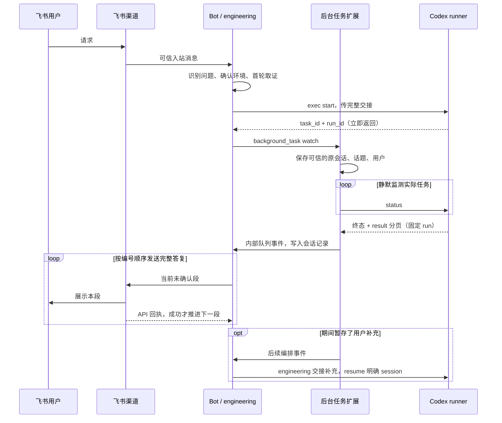

# 后台任务扩展与 Codex 委派

此扩展让 VikingBot 在长任务运行期间继续接收消息，任务结束后把最终答复发回**启动任务的原会话和话题**。它默认关闭，运行于 macOS/Linux、Python 3.10+ 的常驻 Gateway。单次 CLI 调用没有常驻发送器，不承诺退出后的自动通知。

更新官方代码前，按 [bot-main 上游合并影响](upstream-merge-impact.md) 核对核心接入点、扩展依赖及合并后回归。

## 消息链路与职责



engineering 是按需加载的编排 skill，负责目标、环境和授权判断，不是常驻消息代理。Codex 负责代码工作，按交接使用共享业务 skills/MCP 自行补证。正常完成、需要用户补充、发现阻塞三种最终答复，都可由扩展直接交给 Bot 发送，不再让 engineering 调用模型改写。用户回复后，由 Bot 按 engineering 处理新的动作。

codex skill 和 runner 不接触飞书会话标识、服务台路由或发送 API。Bot 的渠道层负责发送。扩展只接受来自 `ToolContext` 的渠道信息，模型参数没有目的会话字段；原始消息正文中的 `source` 不会成为可信来源。内部续办沿用父任务已经确认的环境，不伪造新的服务台来源。

## 与 Hermes 的对应关系

参考 [Hermes terminal tool](https://github.com/NousResearch/hermes-agent/blob/main/tools/terminal_tool.py)、[process registry](https://github.com/NousResearch/hermes-agent/blob/main/tools/process_registry.py) 和 [gateway watcher](https://github.com/NousResearch/hermes-agent/blob/main/gateway/run.py) 的模式：后台登记、保存原始路由、静默监测、内部事件排队、渠道回传。

本实现复用已有 Codex runner 管理进程，不复制一份进程管理器。VikingBot 的 `exec(command, working_dir)` 没有 Hermes 的 PTY/process.submit 接口；Codex 使用非交互 `exec` 和明确 session 的 `resume`。用户补充在 Bot 暂存，下一轮通过交接文件恢复，不向存活进程注入 stdin。Hermes 的完成事件通常唤起 Agent；这里按本部署要求，让普通最终结果直接发送，只有待执行的补充需要新的 Agent 轮次。

## 配置与部署

在现有 Bot 配置内增加以下字段。合并到原配置，勿用此片段替换其他配置：

```json
{
  "runtime_extensions": [
    {
      "factory": "vikingbot.extensions.background_tasks:create_extension",
      "options": {
        "poll_interval": 5,
        "command_timeout": 20,
        "max_probe_errors": 5,
        "delivery_retry_seconds": 30,
        "max_delivery_attempts": 5,
        "max_tasks": 100,
        "segment_bytes": 4096
      }
    }
  ]
}
```

默认没有扩展和后台工具。配置中的 factory 是部署者信任的 Python 导入路径，不能来自用户消息。只在主 AgentLoop 注册工具，不在 compile/subagent 中注册。直接执行后端需要既有的 `sandbox.backends.direct.allow_exec=true`；其他后端沿用自身执行权限。扩展始终调用原 session 的 SandboxManager，不启动宿主 shell 绕过远端沙箱。

前置条件：

- Gateway 常驻运行，并有已启用的原渠道发送器。飞书当前 `send()` 已返回实际 API 成功布尔值；无需修改飞书源码。其他渠道若只返回 `None`，不会被认定为发送成功，需先实现可靠回执再启用此能力。
- 实际执行环境内安装 Codex CLI、Python 和支持协议 v2 的 Wangoon runner。共享业务 skills、命名 MCP 在 Bot、Codex 两端分别配置。认证由 `wangoon-auth-mcp` 提供，扩展不复制登录文件、headers、token 或 MCP 配置。
- Codex runner 固定 full access 与非交互审批；由部署外层沙箱隔离。分析/实施意图及业务授权仍以交接为准。
- `runner` 参数使用**沙箱内**路径。工作区、项目、交接文件和 skills 在实际 Codex 进程环境中可读。短命 exec 结束后仍需允许 detached worker 存活；会清理全部后代进程的沙箱不支持这种部署。
- 宿主 workspace 要持久化。扩展 journal 默认在 `<Bot宿主工作区>/tmp/wangoon/background_tasks/`；可通过 `state_dir` 显式指定持久目录。Codex 的任务状态和日志在其执行工作区的 `tmp/wangoon/codex/tasks/`。两者可能位于不同容器，不能混淆。

目录权限 0700，journal 文件 0600，原子替换并 fsync 文件。完整展示文本和编号段落保存于私有 `parts/<watch_id>/<revision>/`，journal 仅保存有界历史预览、文件引用、摘要和发送游标。一个 journal 同时只允许一个 Gateway 持有锁；不支持多副本共享消费。不要将 tmp 中的交接、日志和路由记录加入 Git。`max_tasks` 包括已结束登记，不自动删除调查证据。

## 工具与完整使用流程

先按 engineering 准备一次性的脱敏交接文件。以下路径仅作示例，替换为当前执行环境的实际路径：

```text
exec(
  command="python3 /skills/codex/scripts/codex_task.py --workspace /workspace start --cwd /workspace/project --skills-root /skills --context-file /workspace/tmp/wangoon/engineering/task/handoff.md --mode implement --structured-result",
  working_dir="/workspace"
)
```

返回实际 task_id 后立即登记（不要把 exec 返回或 launcher PID 当作任务完成）：

```json
{
  "action": "watch",
  "task_id": "<start返回的task_id>",
  "runner": ["python3", "/skills/codex/scripts/codex_task.py", "--workspace", "/workspace"]
}
```

这里调用的工具名是 `background_task`。`runner` 是命令 argv 前缀，所有全局参数放在前缀里，扩展自行追加 `status/result/logs/stop <task_id>`。如使用自定义 `--state-dir`，前缀必须传入相同值。参数经 `shlex.join` 逐项转义，再调用沙箱的字符串执行接口。禁止在 argv 或队列里放凭据。

登记返回 `id`，后续作为 `watch_id`。Bot 应记录 task_id、run_id、watch_id，告诉用户已启动即可，后续静默监测。

| action | 行为 |
| --- | --- |
| `watch` | 先读 runner status，绑定实际 task/run 和可信会话；重复登记同一任务同一轮幂等 |
| `list` | 当前会话的登记摘要，`next_part` 是已确认段数，`part_count` 是总段数；包括暂存补充、`delivery_error` 和 `watch_error` |
| `poll` | watch 绑定的准确 run 状态，支持已保存历史轮次；不把进程退出等同于业务完成 |
| `logs` | 末尾 100 行、最多 64 KiB，保留截断标记 |
| `enqueue` | 暂存 `text`，最多 20 条，每条 4000 字符；不向 Codex stdin 写入 |
| `stop` | 先使旧续办失效，再以 `--expected-run-id` 委托 runner 校验并取消；旧 watch 不会停止新 run |
| `retry` | 存储/执行环境修复后恢复该 watch 的监测或当前未确认段；已有待回执消息时保留该消息及预算，只恢复监测。已确认段不重发，不重跑 Codex |
| `ack` | 暂存补充已交接给后续任务后确认清队列；须在 resume 和新 watch 成功后调用 |
| `forget` | 删除已发送、已结束、无待交接补充的登记、完整展示文本、编号段和该 watch 的查询中转文件；不删除 runner 输出、代码或 Git 会话 |

除 list/watch 外需 `watch_id`。控制操作要求原会话和原用户身份，跨会话不允许重新绑定/停止。`resume <task_id> --expected-run-id <旧run_id> --context-file <追加交接文件>` 使用 runner 保存的明确 Codex session ID，成功后为**新的 run_id 重新 watch**。扩展的 status/logs/result 总是带 `--run-id`，旧 watch 仍可读取已保存的旧终态和结果，不跟随新 run；未保存的旧轮次明确报错，不读取最新轮次代替。stop/resume 的期望 run 在 runner 登记锁内、任何状态调和或信号之前校验；`run_changed` 表示未执行此命令，不能去掉参数重试。

## 补充、取消与人工确认

普通补充经 engineering 判断属于同一问题后用 enqueue 暂存。Codex 当前一轮保持原交接；所有结果段均成功回传后，扩展将补充交回 Bot，触发 engineering 处理下一轮，随后 resume、watch、ack。新一轮只处理新增要求，不重复发布已发送的最终答复。

明确取消、目标纠正或环境变化：先 stop 并核实任务进入终态且没有 `cleanup_required=true`，取消旧队列自动续办，再按用户新范围处理。stop 意图与递增 generation 在执行命令前持久保存；已排队的续办在真正执行前用宿主 `before_process` 回调核对同一 watch、generation 和 dispatched 状态，已取消事件直接跳过，不调用模型或工具。工具轮次中断或命令失败也不会让旧队列自动续办；但不能因此声称实际进程已停止。停止不撤销已经完成的文件修改或外部操作；核查已有 diff 与证据。新目标不得通过给运行任务追加指令来假定旧范围已失效。

本扩展不提供飞书即时取消入口，也不扩展上游通用 interrupt 的行为。上游已有的 OpenAPI CLI 会话中断接口保持原样；内部续办不接入该接口。飞书自然语言“取消”仍作为普通消息排队，不能宣称消息一到达就打断编排或停止 Codex。需要停止任务时，在 Bot 处理到消息后核实明确的 watch/task/run，再调用原有 stop 并核验终态；群里有多个任务时先明确目标，不按整个群会话猜测。内部结果通知仍只排队投递，不调用模型，也不注入正在执行的用户轮次。

Codex 使用 `--structured-result` 后最终答复为 `{ "status": "completed|needs_input|blocked", "text": "直接展示给用户的完整答复" }`。runner 校验格式；`succeeded` 只表示 CLI 退出 0。格式无效、结果缺失或截断不会被认定为业务完成。`needs_input/blocked` 直接展示问题或阻塞事实；用户回答后，Bot 根据当前授权继续原 session。扩展不自动批准、不自动重跑、不扩大环境范围。

## 分页、分段与历史

runner 的 `status` 必须声明 `protocol_version>=2`；旧协议直接拒绝登记，升级扩展时同步升级 runner，不降级成缺少 run 校验的 stop。runner 的普通 `result` 保留旧 CLI 格式；扩展使用：

```bash
python3 /skills/codex/scripts/codex_task.py --workspace /workspace result <task_id> --run-id <run_id> --format page --offset 0 --max-bytes 65536
```

每页只有一份 `text`。`max-bytes` 限制整个 JSON 响应的 UTF-8 字节数（包括转义、元数据和结尾换行），不是仅限制正文。`offset/next_offset` 计 UTF-8 字节，不拆开字符；下一页从前一页的 `next_offset` 读取，直到 `eof=true`。所有页的 task/run/state、长度、格式状态和 SHA-256 必须一致。完整答复校验成功后才准备发送，不混用其他轮次或半份结果。结构化 JSON 在分页前整体解析，不会把截断的 JSON 误报为格式无效。

完整原始答复读取上限 64 MiB（默认任务日志总预算 50 MiB），扩展最多读取 8192 页。超过输入上限时 runner 返回明确的 `outcome_error=result_too_large` 和说明，扩展展示此限制，不声称工作完成或任务仍在运行。原始文件保留供现场检查。

`segment_bytes` 默认 4096，可设为 1024..8192；它计算每条消息**转义后的 JSON 字符串**大小，包含 task/run 和“第 i/N 段”。这不是整个渠道 API 请求的字节预算，部署时应为渠道封装留余量。优先按段落/行拆分，超长行按 Unicode 字符拆分，普通 Markdown 代码围栏在分段边界闭合、下一段重新打开。原始展示文本完整保存在 `source.txt`；不摘要、不裁掉长答复。

每个 watch 同时只有一个待确认段。发送成功回执后，原子保存 `next_part`，再排下一段；失败、超时、进程重启或 retry 只重试当前未确认段。每段有独立有限重试预算，回执携带 part index 和随机 epoch，旧尝试的迟到回执不能跳过后续段。只有所有段确认后才标记 `delivery=sent`、派发暂存补充的 engineering 续办。

回执提交先保存候选状态，成功后才推进内存游标。文件写入失败时保留最后已保存的游标，在内存暂存本次回执，按 `delivery_retry_seconds` 间隔重试保存，最多 `max_delivery_attempts` 次（与发消息的尝试次数分别计数）。暂存期间不重发消息、不把回执误判为发送超时；重试保存时保留期间发生的 stop、队列和授权状态变化。持续失败则释放投递占用，在当前进程中标记 `delivery=failed`、`delivery_error=receipt_journal_failed`，存储修复后可显式 retry。存储不可用时这个失败标记未必能保存；重启仍以最后保存的游标及发送预算为准，最后未确认段可能重复。存储尚未修复时 retry 失败不会在内存中重置预算或偷偷恢复发送。

短答复照常完整写入一次会话历史。多段答复在历史中保存最多 24000 字符的预览、完整展示文本文件引用和任务标识，避免后续模型输入过大；完整文本不塞入 journal 或每段重复写入历史。历史已保存不代表渠道已确认，进度以 `next_part/part_count` 和 delivery 为准。

## 故障、重启和投递语义

- 活动态 `starting/running/stopping`，终态 `succeeded/failed/stopped/timed_out/log_limit/interrupted`。CLI 退出 0 与业务完成分别判断；`needs_input/blocked` 直接显示。原始 answer 和日志仍由 runner 保存。
- 每次查询有限时，最多 4 个并行沙箱命令，通用 JSON 上限 1 MiB，结果分页使用 64 KiB。连续失败时暂停监测；已知终态明确说“已结束但答复读取失败”，未知状态才说“可能仍在运行”，均不自动重启任务。
- 每个 watch 有独立监测协程、轮询间隔和投递唤醒信号。一个任务的慢 status 或多页 result 不会构成其他任务后续分段的等待屏障；某段回执只唤醒对应 watch，不增加其他运行任务的查询频率。并行命令仍受全局 4 个槽位限制，主循环繁忙时结果通知仍需排队。关闭扩展会取消并等待所有 watch 协程退出，再释放 journal 锁和沙箱。
- 登记、暂存补充、确认补充及续办派发先保存候选状态，成功后才更新内存。登记写入失败不留下内存中的成功登记；追加失败可重试，不会多出一次补充；ack 失败保留原队列。结果分段和发送准备也遵循此提交顺序。
- 单个 watch 的 journal、结果文件或监测协程异常只暂停该 watch，以 `watch_error=watch_failed` 显示；不自动重启该协程，不影响其他任务，也不禁用 `list/poll/logs/retry`。存储修复后显式 retry 清除此标记并恢复监测，保留已确认段和已派发续办的决定。已有待回执消息时只恢复监测，不作废其回执或提前重发。故障标记会尽力保存；存储不可用时只能留在内存，重启仍以最后保存的状态恢复，不能声称已持久暂停。
- 查询经执行工作区内 `tmp/wangoon/background_tasks/probes/<id>/<action>.json` 中转后限量读取，避免终端截断。每次还核对 exit 0 后产生的唯一确认标记，命令失败不读取旧文件。中转文件按 watch/action 覆盖、私有权限；登记前 status 使用会话/task 的固定散列，确认不用后可手动清理。
- 完成事件排在正在执行的用户轮次之后，再写历史和发送；不会当成用户 steer，也不消耗用户中断计数。普通完成不调用 LLM。原会话、root、回复锚点和用户身份只在登记时绑定，后续消息不会替换目的会话。
- 无渠道、失效锚点、权限不足、异常或未明确返回 True，均不认定发送成功。耗尽当前段预算后 `delivery=failed`，通过 list 查看并显式 retry；已成功发送的答复 retry 不会整份重发。
- journal 在入队/发送前持久保存。重启恢复未确认段并查询幸存任务；沙箱销毁导致的异常退出由 runner 识别。**不自动 start/resume 写任务。** 旧单消息 journal 会迁移为编号段，已经确认发送的登记不重发；升级前曾截断的内容不能凭旧 journal 恢复，可按明确 run 读取 runner 原始结果核实。
- 渠道已发送、确认游标尚未落盘时崩溃，重启可能重复最后一个未确认段；不能承诺远端严格只发一次。确认过的早先各段不会整份重发。历史按 watch/revision 去重。
- 暂存续办采用至多一次派发：先标记 dispatched 再入队。窗口内崩溃或续办失败，需要按 list 的保留队列和实际 runner run 核实后恢复，避免重复写入；成功 resume、watch 后才 ack。取消 generation 校验在执行入口再次生效。
- 停止不回滚已有改动；恢复前看状态、diff 和证据。停止/恢复和进程清理由 runner 实现，扩展不按名称杀其他进程。中断编排也不等同停止外部任务。

本版不提供周期性飞书进度刷屏、PTY 交互、存活任务 stdin 注入或跨 Gateway 多副本调度。可以用 poll/logs 按需查询；任务预算由 runner 的有限 timeout 和日志限制控制。

## 注释、维护与测试

业务实现集中于 `vikingbot/extensions/background_tasks/`，源码中的类与方法注释解释了状态归属、路由信任边界、沙箱路径、重启和投递窗口。`extensions/runtime.py` 提供通用 `create_extension(context, options)` / `start()` / `close()` 接口。核心补丁只有配置导入入口、主循环生命周期与内部事件、消息结构和发送回执；没有 Codex 或飞书业务分支。后续可将扩展目录打成独立 Python 包，修改 factory 导入路径，不复制 AgentLoop，也不 monkey patch。更新上游后重点回归这几个通用接缝。

本地测试不调用付费 Codex、MCP 或飞书 API：

```bash
PYTHONPATH=bot:. python -m pytest -c bot/pytest.ini bot/tests/test_background_tasks.py bot/tests/test_background_task_segments.py bot/tests/test_channel_delivery_metadata.py bot/tests/test_agent_loop_outcome.py
python3 /path/to/agent-skills/wangoon/codex/tests/test_codex_task.py
```

覆盖实际终态、零模型直接回传、原话题隔离、旧 watch 不能停止新 run、排队续办失效校验、内部续办不扩展上游中断行为、600 KiB 以上有效答复、分页游标/摘要/归属校验、Unicode 和代码围栏分段、中段失败与重启续发、回执写入故障和有界恢复、登记/补充/ack 写入失败后重试、单任务故障隔离和重启后显式恢复、恢复时保留待回执消息、慢查询隔离且不增加无关轮询、全部确认后才续办、有限预算与参数转义。真实部署还需在非生产环境验证沙箱允许 detached worker、原飞书话题/服务台发送锚点可用、MCP 和共享 skills 双宿主均已配置。
