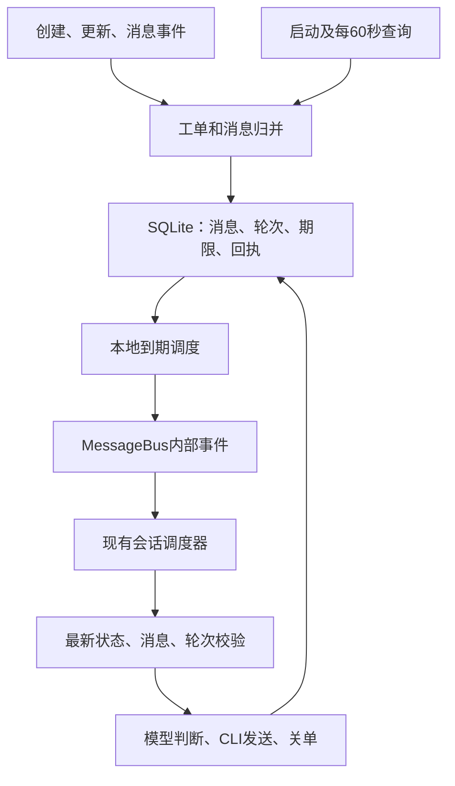

# 服务台主动跟进

VikingBot 使用三条协作链路：同一飞书长连接接收事件，启动及每 60 秒主动增量查询服务台，本地持久化期限到期后将工作送入现有会话调度器。**5 分钟为业务静默间隔，60 秒为补漏周期。**



## 部署配置与身份

在现有 `ov.conf` 中使用 OpenViking 的配置结构：

```json
{
  "bot": {
    "agents": {"max_concurrent_sessions": 4},
    "channels": [{
      "type": "feishu",
      "enabled": true,
      "app_id": "cli_your_app",
      "app_secret": "<应用 Secret>",
      "helpdesk": {
        "enabled": true,
        "helpdesk_id": "<服务台 ID>",
        "helpdesk_token": "<服务台 Token>",
        "followup_interval_minutes": 5,
        "messages": {
          "prefix": "【服务台自动消息】",
          "welcome": "你好，请描述遇到的问题，并补充相关截图或报错信息。",
          "second_reminder_suffix": "如仍未收到你的补充或确认，{minutes}分钟后将自动关闭本工单。",
          "closed_resolved": "问题已解决，工单已关闭。",
          "closed_timeout": "因两次提醒后仍未收到业务补充或确认，工单已关闭。"
        },
        "cli": {
          "executable": "/absolute/path/to/bin/lark-cli-helpdesk",
          "profile": "support"
        }
      }
    }]
  }
}
```

`followup_interval_minutes` 默认 `5`，为严格正整数，不接受字符串、布尔值、小数和零。首次提醒、第二次提醒及最终关单等待共用此配置，修改后重启生效；连续成功提醒次数固定两次。

`messages` 可全部省略，默认值如上。欢迎、跟进及关闭说明统一为 `prefix`、换行和正文；欢迎及两种关闭说明由配置生成，不调用模型。跟进正文仍结合对话生成，第二次业务提醒追加配置的 `second_reminder_suffix`，其中必须且只能出现一次 `{minutes}`。统一标识和固定文案不能为空，修改后重启生效。已尝试发送的消息保留当时的完整文案和 UUID，对账不受配置改动影响。

先按 [CLI 兼容补丁说明](../../../compat/lark-cli/README.md) 构建私有副本，再用对应应用的 CLI profile 完成用户授权。欢迎、提醒、关闭说明和关单均显式 `--as user`；读取工单、消息、订阅使用原应用授权加服务台 Token。不在 Bot 中配置、读取或复制 CLI 用户 Token；续期由 CLI 自身完成。

除了既有机器人和成员查询权限，应用需开通 `helpdesk:all:readonly` 读取/订阅权限。当前 CLI 用户需要有目标工单访问权限，以及 `helpdesk:all`、`im:message.send_as_user`、`im:message`、`im:chat.members:write_only`、所需的消息读取权限和 `offline_access`。用户读取群消息还受 `im:message.group_msg:get_as_user` 和群成员关系约束。应用权限与 OAuth 授权都必须生效。例如在运行 Gateway 的系统账号下：

```bash
/absolute/path/to/bin/lark-cli-helpdesk --profile support auth login \
  --scope "offline_access helpdesk:all im:message.send_as_user im:message im:chat.members:write_only im:message:readonly im:message.group_msg:get_as_user"
```

容器/服务器需保留 CLI 配置、安全凭据存储及必要解密材料。只挂载 `config.json` 不够。保持原有 `allow_from`、命令授权、`@Bot`、媒体和沙箱设置；监测人工活动不要求 `@Bot`。启动仍使用 `vikingbot gateway` 或 `openviking-server --with-bot`。

## 发现、补漏与恢复

- 长连接订阅工单创建、更新及 `helpdesk.ticket_message.created_v1`。Agent 回答仍只由标准 IM 触发，工单消息事件仅监测。服务台消息 ID 和 IM ID 合并去重。
- 首次启用时间持久化，只接管其后新建且未关闭的工单；停机期间此后的新工单会补接管。首次启用前的历史工单保持原有 IM 使用方式。
- 分别按创建时间和更新时间分页查工单，窗口重叠 60 秒；完整分页成功才推进相应游标。超过一万条时拆分时间窗口，无法完整枚举则保留原游标。工单查询时间单位为毫秒。
- 每个已接管的未关闭工单独立轮询消息，不依赖工单 `updated_at`。消息查询时间为秒，返回记录时间为毫秒。计时用消息产生时间；页数/总数异常和失败不推进消息游标。
- 群关联取可信事件，或通过工单中有效 `om_` 消息 ID 查询 IM 详情。缺少权限时保留待绑定，不猜群名、不猜目标。冲突关联拒绝合并。恢复绑定后沿用现有 Bot 入群流程。
- 重启先同步状态和漏掉的消息，再放行到期动作；不依据不完整或来源未核实的对话自动关单。停机期间错过多轮期限，只执行当前一次提醒，下一次从本次成功时间计算。
- 正常流程中，关闭后再次提问创建新工单，按新 ID 独立接管和欢迎。兼容外部系统将同一 ID 重新设为开放：增量列表先持久化待核对标记，再读取最新详情确认；详情失败或重启不会丢失标记。确认后清零本轮次数、保留欢迎记录，等待新的人工沟通后再判断，避免旧的解决结论立即关单。迟到的创建事件不能直接重新打开工单。

## 欢迎、计时和关单

新工单欢迎成功一次，不调用模型，默认发送：

> 【服务台自动消息】
>
> 你好，请描述遇到的问题，并补充相关截图或报错信息。

欢迎语不包含时间。尚无人工沟通时从欢迎成功发送时间计时；有人工消息后按最后人工沟通时间。新人工消息到接收层立即清零本轮提醒、更新版本并作废旧期限，不等待 Agent 消费。所有话题的文本、图片、文件均计入人工活动。自动欢迎、跟进、关闭说明及系统消息不重置；同一 CLI 用户的手动沟通仍计入。

| 场景 | 跟进内容 | 两次成功跟进后 |
| --- | --- | --- |
| 等待处理方响应、调查或解决 | 请产品／研发／测试响应并推进实际问题 | 停止本轮催办，保持开放 |
| 等待业务描述或补充 | 请业务描述问题或补充信息 | 再静默一个间隔后关单 |
| 等待业务验证或确认 | 请业务验证或确认结果 | 再静默一个间隔后关单 |

默认时间线为静默满 5 分钟第一次提醒，成功后再等 5 分钟第二次提醒，第二次成功后再等 5 分钟才可超时关单。失败不增加次数、不推进关单期限。第二次面向业务的提醒由代码追加配置中的 `N分钟后将自动关闭本工单` 规则，模型不得编造期限。

人工沟通触发及时判断。业务确认，或模型引用可信人工消息、包含最新消息且有充分事实证明已解决时，可直接关单，`solved=2`。业务无回复关单仅适用于上表两种等待业务场景，必须已成功提醒两次且再静默一个间隔，`solved=1`。等待处理方解决期间不会因业务静默关单。

判断使用独立无工具输入，受 `session_context_token_budget` 限制，不加载 Agent 的完整历史和工具结果。身份不明、仅附件无法判断、信息不足或模型错误时暂缓关单。文案结合对话，不虚构进展、负责人或完成时间。关单修改服务台工单状态，不关闭聊天页面；远端确认关闭后再发说明。

## 并发、过期保护和退出

欢迎、判断、提醒及关单通过 `internal_handler` / `before_process` 进入现有会话队列，共用 `max_concurrent_sessions`。值为 `1` 时全局串行，示例值 `4` 时跨会话并发；同完整 SessionKey 串行。同工单重复待办合并，内部事件不进入用户中断计数、不 steer 到活动回答。扫描与计时任务只生产状态和待办，不增加模型执行池。

出队、模型返回、发送和关单前检查版本。人工消息改变版本后，旧判断作废。关单在等待 CLI 授权和操作锁后再读取最新状态和消息；同群任意话题有执行、排队或最终保存任务时推迟，cron、heartbeat 等 `process_direct()` 调用也计入忙碌状态，直至保存和清理完成。服务台没有条件更新版本参数，最终读取与远端 PUT 之间仍有网络边界；版本检查覆盖已经收到的消息。

本地到期任务按最近期限等待，最多 10 秒校准一次自然时间。执行额度不足时允许排队，到执行时重新验证。另有独立的后台异步任务只查询发送回执、恢复本地记录，不调用模型、不重发旧轮提醒、不关单，不受工单自动化暂停影响。它与普通人工消息交付分开运行，仍与其他 CLI 操作共用锁。停止渠道先停接收和入队、使旧待办失效，取消并等待监测、回执查询及执行回调，再关闭数据库、CLI 和 HTTP。保持单个 AgentLoop、一套 MCP 和扩展实例，普通 Bot 发送 API 并发及外部文件规则不变。

## 持久化和不确定回执

状态位于 `{storage_workspace}/bot/helpdesk/<应用与服务台的SHA256>/state.sqlite3`，SQLite WAL 和单实例文件锁保护，目录及数据库限制本机权限。记录启用时间、独立查询游标、绑定、消息别名、轮次、欢迎时间、人工活动、次数、期限依据及 outbox，不保存 OAuth 或服务台凭据。

发送前持久化 UUID、完整文案和当前 CLI 用户。同轮回执丢失时在 CLI 一小时消息幂等窗口内以同 UUID 重试；取得 CLI 锁并完成授权后再次检查有效期。超过 3500 秒仍不确定，或旧轮提醒回执不确定且已有新人工沟通时，仅暂停该工单的自动发送和关单，保存 `paused` / `pause_reason` 并记录 `Helpdesk automation paused`。发送使用 CLI 原生 API 保留飞书的毫秒时间，幂等重试沿用原消息的发送时间；缺少有效时间的回执不推进提醒次数或期限，等待对账。后台对账继续以 CLI 用户身份分页查询目标群历史，按用户、目标群、完整文案及发送时间窗口确认回执，不重新发送已过期动作。全部不确定发送确认后自动解除回执原因导致的暂停；旧轮回执不增加新轮次数。查询失败或未确认时保持自动化暂停，人工消息仍正常处理；必要时人工核对远端消息和本地 outbox，不能删除数据库冒充首次启用。

CLI 自身消息可能先产生回调、后返回发送回执。接收层依据已有发送记录识别并保存早到的自动消息回执；不会因为发送人和 CLI 用户相同而暂存其所有消息。客服手动沟通立即交给原生 IM，回执查询或自动化暂停均不阻塞它，也不再产生等待回执的内存消息队列。仅有统一标识的消息不能冒充本机自动发送，仍须匹配发送记录。工单关闭后继续识别自动回流，关闭说明不会进入普通回答。欢迎和关闭说明使用持久化幂等键；兼容同 ID 再次关闭时使用新的关闭轮次键。关单响应丢失时，恢复流程核对关闭状态和备注是否匹配本次操作，然后补发关闭说明。

## 验证

自动测试使用本地模拟，不发送真实飞书消息或关单：

```bash
PYTHONPATH=bot:. python -m pytest -c bot/pytest.ini \
  bot/tests/test_helpdesk_delivery.py \
  bot/tests/test_helpdesk_followup.py \
  bot/tests/test_helpdesk_followup_concurrency.py \
  bot/tests/test_feishu_helpdesk.py \
  bot/tests/test_feishu_helpdesk_api.py \
  bot/tests/test_feishu_helpdesk_cli.py \
  bot/tests/test_agent_session_concurrency.py \
  bot/tests/test_session_dispatcher.py \
  bot/tests/test_message_source_context.py \
  bot/tests/test_background_tasks.py \
  bot/tests/test_background_task_segments.py -q
```

部署前在测试服务台核验真实长连接、Token、当前用户访问权限、5／10／15 分钟时间线及停机补漏。上游接入点和验证记录见 [合并说明](helpdesk-followup-merge.md)。

## API 依据

- [工单查询](https://open.feishu.cn/document/server-docs/helpdesk-v1/ticket-management/ticket/list.md)、[详情](https://open.feishu.cn/document/server-docs/helpdesk-v1/ticket-management/ticket/get.md)
- [消息查询](https://open.feishu.cn/document/server-docs/helpdesk-v1/ticket-management/ticket-message/list.md)、[消息事件](https://open.feishu.cn/document/server-docs/helpdesk-v1/ticket-management/ticket-message/events/created.md)
- [订阅](https://open.feishu.cn/document/server-docs/helpdesk-v1/event/subscribe.md)、[用户关单](https://open.feishu.cn/document/server-docs/helpdesk-v1/ticket-management/ticket/update.md)、[IM 详情](https://open.feishu.cn/document/server-docs/im-v1/message/get.md)
- [IM 群历史与回执对账](https://open.feishu.cn/document/server-docs/im-v1/message/list.md)
